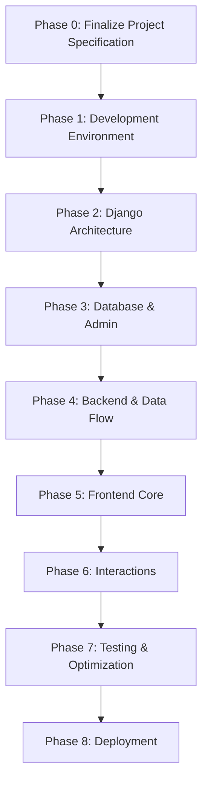

# THE DEEP SEA EXPLORER – HÀNH TRÌNH THÁM HIỂM BIỂN SÂU

> **Tài liệu Đặc tả Kỹ thuật và Kiến trúc Dự án – Phiên bản 1.0 (Chính thức)**  
> Trạng thái: Đã phê duyệt kiến trúc – Chuẩn bị triển khai  
> Ngôn ngữ tài liệu: Tiếng Việt  
> Định vị tài liệu: Tài liệu tham chiếu duy nhất và chính thức cho toàn bộ quá trình phát triển dự án.

---

## 1. Tổng quan dự án

### 1.1. Tên dự án
**The Deep Sea Explorer – Hành trình thám hiểm biển sâu**

### 1.2. Mục tiêu
Xây dựng một ứng dụng web tương tác mô phỏng hành trình lặn từ mặt biển ($0\text{ m}$) xuống khu vực Challenger Deep thuộc rãnh Mariana. Độ sâu mục tiêu hiện tại của hành trình là **$10.928\text{ m}$**.

Website tập trung vào trải nghiệm khám phá trực quan: người dùng cuộn trang để đi sâu dần xuống đại dương, quan sát môi trường thay đổi theo độ sâu, khám phá các sinh vật đặc biệt và các cột mốc lịch sử, địa lý hoặc văn hóa được đặt dọc hành trình.

### 1.3. Cảm hứng thiết kế
Dự án lấy cảm hứng từ ý tưởng cuộn dọc để khám phá các tầng đại dương của [neal.fun/deep-sea](https://neal.fun/deep-sea/), đồng thời phát triển thêm các khả năng:
- **Quick Jump:** Nhảy nhanh đến một tầng biển hoặc một cột mốc cụ thể.
- **Interactive Inspector:** Mở bảng thông tin khi người dùng chọn một sinh vật hoặc cột mốc.
- **Depth HUD:** Luôn hiển thị độ sâu và các chỉ số môi trường mô phỏng.
- **Minimap/Ruler:** Cho người dùng biết vị trí hiện tại trong toàn bộ hành trình.

Đây là website trải nghiệm khám phá và giáo dục trực quan, không phải website tra cứu dữ liệu dạng danh sách đơn thuần.

### 1.4. Đối tượng người dùng
- Học sinh, sinh viên muốn khám phá các tầng đại dương và khoa học biển.
- Người dùng phổ thông quan tâm đến sinh vật biển sâu, lịch sử thám hiểm và các cột mốc đặc biệt dưới biển.

### 1.5. Trải nghiệm cốt lõi
Người dùng có cảm giác đang thực hiện một chuyến lặn ảo liên tục từ mặt biển đến vực sâu nhất. Khi độ sâu tăng lên:
- Màu sắc và độ sáng của môi trường thay đổi liên tục.
- Các chỉ số độ sâu, áp suất và nhiệt độ được cập nhật tức thì.
- Các sinh vật và cột mốc lần lượt xuất hiện trên hành trình.
- Người dùng có thể chọn một đối tượng để xem thông tin hoặc dùng Quick Jump để di chuyển đến vị trí mong muốn.

---

## 2. Phạm vi phát triển & Quy tắc người dùng

### 2.1. Phạm vi phiên bản MVP (Minimum Viable Product)
1. Một hành trình cuộn dọc liên tục từ $0\text{ m}$ đến $10.928\text{ m}$.
2. HUD cố định hiển thị độ sâu, áp suất và nhiệt độ nước mô phỏng.
3. Nền đại dương chuyển màu mượt mà theo từng vùng độ sâu.
4. 5 tầng đại dương và các điểm mốc được bố trí chuẩn xác dọc hành trình.
5. Sinh vật biển và cột mốc có hiệu ứng chuyển động, hover và click.
6. Quick Jump cho phép di chuyển mượt mà đến các vị trí đã định nghĩa.
7. Inspector Drawer/Modal mở và đóng mà không làm mất vị trí cuộn hiện tại.
8. Hiệu ứng môi trường cơ bản: quầng sáng đèn pha tàu lặn và các hạt phát sáng (bioluminescence).
9. Giao diện responsive trên cả máy tính để bàn (desktop) và thiết bị di động (mobile/tablet).

### 2.2. Nội dung chưa cần hoàn thiện ở giai đoạn MVP
**Chưa triển khai nội dung chi tiết bên trong Inspector.** Cụ thể:
- Chưa viết bài mô tả khoa học đầy đủ cho từng sinh vật/cột mốc.
- Chưa tạo trường `inspector_content` hoặc cấu trúc dữ liệu chi tiết riêng cho từng loại đối tượng trong database.
- Chưa tải và lưu trữ toàn bộ ảnh tư liệu về local.
- Chưa bổ sung các chỉ số sinh học chuyên sâu hay Fun Fact hoàn chỉnh.
- *Ở giai đoạn MVP:* Chỉ cần lưu trữ và hiển thị tên đối tượng, tên khoa học (nếu có), độ sâu, tầng đại dương, mô tả ngắn phục vụ tooltip/thẻ tóm tắt và xây dựng khung giao diện Inspector có khả năng mở rộng.

### 2.3. Quy tắc người dùng và quản trị hệ thống
- **Không có tài khoản người dùng công khai:**
  - Không xây dựng đăng ký (registration), đăng nhập/đăng xuất (public login/logout).
  - Không xây dựng hồ sơ cá nhân (user profiles), quên mật khẩu người dùng thông thường.
  - Không hỗ trợ đăng nhập mạng xã hội (social login).
  - Không có chức năng bình luận (comments), đánh giá (ratings) hay lưu lịch sử thám hiểm cá nhân.
  - Mọi khách truy cập đều có thể trải nghiệm toàn bộ website công khai mà không cần tài khoản.
- **Quản trị hệ thống (Admin):**
  - Giữ lại Django Admin tiêu chuẩn tại đường dẫn: `/admin/`.
  - Chỉ dành riêng cho quản trị viên được cấp quyền để quản lý dữ liệu (tầng biển, sinh vật, cột mốc, nguồn tham khảo).
  - Tuyệt đối không tạo nút, banner hay liên kết dẫn đến trang Admin trên giao diện website công khai.
  - Không dùng Django Admin để can thiệp vào logic vận hành hay giao diện trực tiếp của người dùng.

---

## 3. Kiến trúc giao diện người dùng (UI/UX)

Giao diện được phân tách thành ba lớp (layers) rõ ràng:

### 3.1. Lớp HUD cố định (Fixed Navigation & Status Bar)
HUD luôn neo ở vị trí cố định trên màn hình (z-index cao):
- **Đồng hồ độ sâu (Depth Counter):**
  - Hiển thị độ sâu hiện tại theo mét ($0\text{ m} \to 10.928\text{ m}$).
  - Cập nhật số mượt mà theo vị trí cuộn. Khi Quick Jump hoạt động, đồng hồ nhảy số liên tục theo hành trình lướt qua.
- **Chỉ số môi trường mô phỏng:**
  - *Áp suất thủy tĩnh gần đúng:* $P \approx 1 + (\text{độ sâu} / 10)\text{ atm}$.
  - *Nhiệt độ nước mô phỏng:* Bắt đầu từ khoảng $24^\circ\text{C}$ tại mặt biển, giảm dần xuống khoảng $1{,}5^\circ\text{C}$ ở điểm cuối hành trình.
- **Quick Jump Menu:**
  - Nút mở menu chuyển tầng nhanh trên HUD.
  - Hiển thị danh sách 5 tầng đại dương và các cột mốc đáng chú ý kèm độ sâu tương ứng.
  - Khi chọn một mục, website cuộn mượt (smooth scroll) đến đúng vị trí, đồng thời có hiệu ứng phản hồi trực quan khi chạm đích.
- **Minimap / Vertical Ruler:**
  - Thước đo dọc đặt sát cạnh phải màn hình biểu thị toàn bộ hành trình $0 - 10.928\text{ m}$.
  - Có con trỏ chỉ vị trí hiện tại của người dùng.

### 3.2. Sân khấu khám phá (Center Stage Canvas)
- **Hành trình cuộn dọc:** Điểm bắt đầu tại $0\text{ m}$ và kết thúc tại $10.928\text{ m}$.
- **Hệ quy chiếu đồng nhất:** Chiều cao vùng cuộn, tọa độ xuất hiện của các đối tượng, độ sâu trên HUD và điểm đến của Quick Jump phải sử dụng chung một hệ quy chiếu toán học. Xử lý chính xác giới hạn cuộn và chiều cao viewport (`window.innerHeight`) để đảm bảo khi thanh cuộn chạm đáy, HUD hiển thị đúng $10.928\text{ m}$ và đối tượng ở vực sâu nhất xuất hiện trọn vẹn trong tầm nhìn.
- **Chuyển màu nền theo độ sâu:**
  - $0 - 200\text{ m}$: Xanh ngọc bích sang xanh dương tươi sáng (`#1ca7d0` $\to$ `#0d5c8a`).
  - $200 - 1.000\text{ m}$: Xanh coban sang xanh thẫm pha tím (`#0d5c8a` $\to$ `#101c42`).
  - $1.000 - 4.000\text{ m}$: Tím than chuyển dần sang đen ánh xanh (`#101c42` $\to$ `#080b18`).
  - $4.000 - 10.928\text{ m}$: Gần như đen tuyền (`#080b18` $\to$ `#020408`).
- **Hiệu ứng môi trường:**
  - Hạt phát sáng (bioluminescence particles) nhẹ nhàng, số lượng hạn chế.
  - Quầng sáng đèn pha tàu lặn rọi theo con trỏ chuột trên desktop; trên mobile giản lược thành quầng sáng tâm màn hình.
- **Sinh vật và cột mốc:**
  - Xuất hiện tại độ sâu xác định, có animation trôi dạt/bơi nhẹ.
  - Khi hover: phản hồi viền sáng, hiện tooltip tên và thông tin tóm tắt.
  - Khi click: kích hoạt mở Inspector Drawer.

### 3.3. Inspector Drawer / Modal
- Bảng trượt kính mờ (glassmorphism) từ cạnh phải màn hình khi click vào đối tượng.
- Giữ nguyên vị trí cuộn của hành trình khi mở/đóng bảng.
- Đóng bằng nút `X`, click ra ngoài backdrop hoặc nhấn phím `Esc`.
- Trên màn hình di động: hiển thị dưới dạng modal trượt từ dưới lên hoặc toàn màn hình, có cơ chế khóa cuộn nền an toàn.

---

## 4. Các tầng đại dương và dữ liệu hành trình

*(Toàn bộ các mốc và sinh vật ban đầu được bảo toàn nguyên vẹn; các ghi chú cần xác minh được giữ lại để đối chiếu)*

### 4.1. Tầng 1 – Epipelagic (Tầng Nắng rọi)
**Khoảng độ sâu:** $0 - 200\text{ m}$  
**Đặc điểm:** Ánh sáng mặt trời dồi dào, hệ sinh thái quang hợp phát triển mạnh.

**Cột mốc và điểm nhấn:**
| Độ sâu | Đối tượng | Ghi chú |
|---:|---|---|
| 17 m | Christ of the Abyss | Tượng đồng dưới đáy vịnh San Fruttuoso |
| 40 m | Giới hạn lặn dưỡng khí giải trí | Mốc tham khảo giới hạn scuba giải trí tiêu chuẩn |
| 100 m | Cá voi xanh | Mốc so sánh kích thước sinh vật khổng lồ |

**Sinh vật:**
- Rồng xanh biển (*Glaucus atlanticus*): Sên biển màu xanh kim loại, trôi ngửa và săn sứa.
- Salp: Nhóm sinh vật phù du thân trong suốt, có khả năng kết chuỗi.

---

### 4.2. Tầng 2 – Mesopelagic (Tầng Chạng vạng)
**Khoảng độ sâu:** $200 - 1.000\text{ m}$  
**Đặc điểm:** Ánh sáng yếu dần, nhiệt độ nước giảm nhanh (thermocline).

**Cột mốc và điểm nhấn:**
| Độ sâu | Đối tượng | Ghi chú |
|---:|---|---|
| 332 m | Kỷ lục lặn sâu của Ahmed Gabr | Kỷ lục lặn Scuba; *cần kiểm chứng số liệu chính thức (332,35 m)* |
| 500 m | Mốc độ sâu tàu ngầm | Mốc so sánh dự kiến; *cần xác minh nguồn trước khi công bố* |
| 828 m | Burj Khalifa | So sánh chiều cao tòa tháp lộn ngược dưới biển |

**Sinh vật:**
- Cá mắt thùng (*Barreleye Fish*): Phần đầu trong suốt, mắt hình ống hướng lên.
- Mực mắt lác (*Cockeyed Squid*): Hai mắt kích thước và hướng nhìn khác nhau.
- Mực ma cà rồng (*Vampyroteuthis*): Xòe màng tay tạo hình dạng giống áo choàng.

---

### 4.3. Tầng 3 – Bathypelagic (Tầng Nửa đêm)
**Khoảng độ sâu:** $1.000 - 4.000\text{ m}$  
**Đặc điểm:** Ánh sáng mặt trời tắt hoàn toàn, bóng tối vĩnh cửu, áp suất tăng cao.

**Cột mốc và điểm nhấn:**
| Độ sâu | Đối tượng | Ghi chú |
|---:|---|---|
| 1.000 m | The Midnight Zone | Mốc bắt đầu tầng Nửa đêm |
| 2.250 m | Vùng săn mồi của cá nhà táng | Minh họa độ sâu lặn săn mồi của động vật có vú |
| 3.800 m | Xác tàu Titanic | Xác tàu đắm năm 1912 dưới Đại Tây Dương |
| 3.810 m | Thảm kịch tàu lặn Titan | Mốc sự kiện năm 2023; *cần xác minh độ sâu mảnh vỡ và cách diễn đạt* |

**Sinh vật:**
- Cá vây chân / Cá cần câu (*Anglerfish*): Có cơ quan phát quang sinh học làm mồi nhử.
- Cá nuốt chửng (*Gulper Eel*): Miệng khổng lồ có thể nuốt con mồi lớn hơn cơ thể.
- Cá rìu biển (*Hatchetfish*): Thân dẹt mỏng, có cơ quan phát sáng ở mặt bụng.

---

### 4.4. Tầng 4 – Abyssopelagic (Tầng Vực thẳm)
**Khoảng độ sâu:** $4.000 - 6.000\text{ m}$  
**Đặc điểm:** Môi trường tĩnh lặng, cực lạnh ($1 - 4^\circ\text{C}$), áp suất cực lớn.

**Cột mốc và điểm nhấn:**
| Độ sâu | Đối tượng | Ghi chú |
|---:|---|---|
| 4.000 m | Độ sâu trung bình của đại dương | Mốc so sánh địa hình; *khoa học ghi nhận ~3.688 m, mốc 4.000m mang tính làm tròn* |

**Sinh vật:**
- Lợn biển sâu (*Sea Pig*): Hải sâm biển sâu có chân ống di chuyển trên bùn đáy.
- Cá răng nanh (*Fangtooth*): Bộ răng lớn nhất tương quan với kích thước cơ thể.
- Giun ống miệng phun thủy nhiệt: Hệ sinh thái hóa tổng hợp, không phụ thuộc ánh sáng mặt trời.

---

### 4.5. Tầng 5 – Hadalpelagic (Tầng Địa ngục)
**Khoảng độ sâu:** $6.000 - 10.928\text{ m}$  
**Đặc điểm:** Rãnh nứt đại dương sâu thẳm, bóng tối hoàn toàn, áp suất lên đến hơn $1.000\text{ atm}$.

**Cột mốc và điểm nhấn:**
| Độ sâu | Đối tượng | Ghi chú |
|---:|---|---|
| 6.500 m | Alvin và Shinkai 6500 | Phương tiện lặn nghiên cứu; *cần phân biệt mốc hoạt động của từng tàu* |
| 6.895 m | Xác tàu USS Samuel B. Roberts | Xác tàu chiến sâu nhất được tìm thấy; *cần kiểm chứng vị trí* |
| 8.848 m | Đỉnh Everest lộn ngược | So sánh chiều cao đỉnh núi cao nhất thế giới |
| 10.928 m | Challenger Deep | Điểm sâu nhất rãnh Mariana – đích đến của hành trình |

**Các mốc thám hiểm Challenger Deep:**
- Chuyến lặn lịch sử của Jacques Piccard và Don Walsh (Tàu Trieste, 1960).
- Chuyến lặn đơn của James Cameron (Tàu Deepsea Challenger, 2012).

**Sinh vật:**
- Cá ốc Mariana (*Mariana Snailfish*): Cá sống sâu nhất từng ghi nhận; *cần ghi rõ nguồn mốc 8.178 m*.
- Amphipod biển sâu: Giáp xác chân đôi thích nghi áp suất cực hạn.
- Xenophyophore: Sinh vật đơn bào khổng lồ sống tại đáy vực.

---

## 5. Kịch bản tương tác người dùng

### 5.1. Khám phá tuần tự (Manual Exploration)
1. Người dùng cuộn chuột hoặc vuốt màn hình cảm ứng để lặn xuống sâu.
2. Màu nền đại dương biến đổi dần từ sáng sang tối theo độ sâu.
3. Đồng hồ HUD nhảy số độ sâu, áp suất và nhiệt độ được tính toán tức thì.
4. Sinh vật và cột mốc xuất hiện trên hành trình với animation nhẹ.
5. Khi hover chuột: con trỏ đổi trạng thái, thực thể phát sáng nhẹ, hiển thị tooltip tên và tóm tắt.

### 5.2. Nhảy nhanh (Quick Jump Navigation)
1. Người dùng nhấn nút Quick Jump trên HUD.
2. Menu hiển thị danh sách 5 tầng đại dương và các cột mốc tiêu biểu.
3. Người dùng chọn một mục (ví dụ: *Titanic – 3.800 m*).
4. Website thực hiện cuộn mượt (smooth scroll) đến tọa độ đích.
5. Trong quá trình lướt qua, HUD và màu nền cập nhật liên tục; khi dừng lại có hiệu ứng highlight nhẹ để báo hiệu đã tới đích.

### 5.3. Tra cứu thông tin (Inspector Trigger)
1. Người dùng click vào một sinh vật hoặc cột mốc.
2. Inspector Drawer trượt vào từ cạnh phải màn hình (hoặc modal trên mobile).
3. Vị trí cuộn của hành trình được khóa giữ nguyên.
4. Người dùng xem thông tin, sau đó đóng bảng bằng nút `X`, bấm ra ngoài hoặc nhấn phím `Esc`.
5. Trang web mở khóa cuộn, người dùng tiếp tục hành trình tại đúng vị trí cũ.

---

## 6. Quyết định công nghệ và Kiến trúc kỹ thuật

### 6.1. Ngăn xếp công nghệ (Technology Stack)
- **Backend:** Python + Django (bản phát hành dài hạn, tương thích `>= 6.1`).
- **Frontend:** HTML5, CSS3 hiện đại, Vanilla JavaScript (ES6+).
- **Template Engine:** Django Templates.
- **Database:** PostgreSQL.
  - *Local Development:* PostgreSQL chạy trực tiếp trên CachyOS.
  - *Production:* Neon PostgreSQL Serverless (độc lập hoàn toàn với local).
- **Package Manager:** `uv` (quản lý dependency và virtual environment nhanh chóng).
- **Version Control:** Git + GitHub.
- **Django Application Name:** `explorer`.
- **Hosting dự kiến:** Render (chạy web service Django).
- **Quy tắc công nghệ MVP:** Tuyệt đối không sử dụng React, Django REST Framework, Redis hay Docker trong giai đoạn MVP để giữ kiến trúc tinh gọn, dễ bảo trì và hiệu năng cao.

### 6.2. Quản lý hình ảnh (Image Management Strategy)
- Giai đoạn đầu ưu tiên sử dụng **URL hình ảnh bên ngoài** được kiểm duyệt bản quyền thay vì lưu toàn bộ file vào project.
- Tuyệt đối **không upload và lưu trữ hình ảnh trên filesystem tạm thời của Render** (tránh mất dữ liệu khi restart container).
- Cloudflare R2 là giải pháp lưu trữ object storage chính thức khi dự án cần tự host hình ảnh trong tương lai.
- Mỗi hình ảnh được lưu trữ với đầy đủ 5 trường thông tin độc lập:
  1. `image_url`: Đường dẫn trực tiếp đến file ảnh.
  2. `image_source_url`: Link trang web gốc chứa hình ảnh.
  3. `image_credit`: Tên tác giả hoặc cơ quan sở hữu bản quyền ảnh.
  4. `image_license`: Giấy phép sử dụng (Public Domain, CC BY, v.v.).
  5. `detail_url`: Đường dẫn bài viết hoặc tài liệu tham khảo chi tiết (phân biệt rõ với URL ảnh).

### 6.3. Luồng dữ liệu (Data Flow)
Tuân thủ luồng truyền dữ liệu một chiều tinh gọn:
$$\text{PostgreSQL} \xrightarrow{\text{Django ORM}} \text{Django View} \xrightarrow{\text{Context}} \text{Template} \xrightarrow{\text{json\_script}} \text{Vanilla JS Store}$$

- View Django truy vấn các đối tượng có `is_published=True`, sắp xếp theo độ sâu.
- Dữ liệu được nhúng trực tiếp và an toàn vào template HTML thông qua filter `json_script`.
- JavaScript đọc dữ liệu JSON khi trang tải xong và khởi tạo DOM.
- **Không gửi bất kỳ request API nào lên backend trong lúc người dùng cuộn trang.**

---

## 7. Thiết kế cơ sở dữ liệu chi tiết (Database Schema)

Hệ thống sử dụng 3 model cốt lõi trong Django app `explorer`:

### 7.1. Model `OceanLayer` (Tầng đại dương)
Quản lý 5 tầng biển:
- `id`: `BigAutoField`, Primary Key.
- `name`: `CharField(max_length=50)` — Tên quốc tế (*Epipelagic, Mesopelagic, Bathypelagic, Abyssopelagic, Hadalpelagic*).
- `vietnamese_name`: `CharField(max_length=100)` — Tên tiếng Việt.
- `depth_start_m`: `PositiveIntegerField` — Độ sâu bắt đầu (m).
- `depth_end_m`: `PositiveIntegerField` — Độ sâu kết thúc (m).
- `sort_order`: `PositiveSmallIntegerField(unique=True)` — Thứ tự tầng từ 1 đến 5 (dùng `sort_order` thay cho `order`).
- `color_start`: `CharField(max_length=7)` — Mã màu HEX bắt đầu dải chuyển màu.
- `color_end`: `CharField(max_length=7)` — Mã màu HEX kết thúc dải chuyển màu.
- `description`: `TextField(blank=True)` — Mô tả tổng quan đặc điểm của tầng.

### 7.2. Model `ExplorerItem` (Sinh vật & Cột mốc)
Quản lý các thực thể xuất hiện trên hành trình:
- `id`: `BigAutoField`, Primary Key.
- `name`: `CharField(max_length=150)` — Tên hiển thị của thực thể.
- `slug`: `SlugField(max_length=160, unique=True)` — Định danh cho anchor / điều hướng.
- `item_type`: `CharField(max_length=20, choices=[('CREATURE', 'Sinh vật'), ('MILESTONE', 'Cột mốc')])`.
- `scientific_name`: `CharField(max_length=150, blank=True)` — Tên khoa học (áp dụng cho sinh vật).
- `depth_m`: `PositiveIntegerField(db_index=True)` — Độ sâu tính bằng mét.
- `layer`: `ForeignKey(OceanLayer, on_delete=models.PROTECT, related_name='items')`.
- `short_description`: `CharField(max_length=255, blank=True)` — Mô tả ngắn hiển thị trên tooltip / tóm tắt.
- **Thông tin hình ảnh bản quyền:**
  - `image_url`: `URLField(max_length=500, blank=True)` — Link ảnh trực tiếp.
  - `image_source_url`: `URLField(max_length=500, blank=True)` — Link trang nguồn ảnh.
  - `image_credit`: `CharField(max_length=200, blank=True)` — Tác giả/đơn vị sở hữu ảnh.
  - `image_license`: `CharField(max_length=100, blank=True)` — Giấy phép sử dụng.
  - `detail_url`: `URLField(max_length=500, blank=True)` — Link bài viết tài liệu ngoài.
- **Trạng thái kiểm duyệt & phát hành (Mặc định False):**
  - `is_verified`: `BooleanField(default=False)` — Đã kiểm chứng nguồn khoa học/lịch sử hay chưa.
  - `is_published`: `BooleanField(default=False)` — Trạng thái xuất bản ra trang công khai.
- `references`: `ManyToManyField('ReferenceSource', blank=True, related_name='items')`.
- `created_at`: `DateTimeField(auto_now_add=True)`.
- `updated_at`: `DateTimeField(auto_now=True)`.

**Ràng buộc & Validation bắt buộc:**
- Ràng buộc độ sâu toàn hệ thống: $0 \le \text{depth\_m} \le 10928$.
- Validation logic (`clean()` method): `depth_m` phải nằm trong khoảng $[\text{layer.depth\_start\_m}, \text{layer.depth\_end\_m}]$ của tầng biển mà nó thuộc về.
- Truy vấn website công khai: Chỉ lấy các đối tượng có `is_published=True`. Đối tượng chưa xác minh (`is_verified=False`) nếu được publish vẫn phải hiển thị kèm nhãn cảnh báo "Dữ liệu đang kiểm chứng".

### 7.3. Model `ReferenceSource` (Nguồn tham khảo khoa học)
- `id`: `BigAutoField`, Primary Key.
- `title`: `CharField(max_length=255)` — Tên sách, bài báo hoặc tài liệu khoa học.
- `url`: `URLField(max_length=500, blank=True)` — Đường link tài liệu.
- `publisher`: `CharField(max_length=150, blank=True)` — Nhà xuất bản / Cơ quan nghiên cứu (NOAA, WHOI, Jamstec...).
- `published_year`: `PositiveSmallIntegerField(null=True, blank=True)` — Năm xuất bản.
- `notes`: `TextField(blank=True)` — Ghi chú kiểm chứng.

---

## 8. Mô phỏng vật lý & Môi trường (Depth Simulation)

Toàn bộ các phép tính toán được thực thi 100% ở Client-side thông qua JavaScript:

### 8.1. Ánh xạ vị trí cuộn và Độ sâu
- **Tỷ lệ thử nghiệm ban đầu:** $1\text{ m} = 4\text{ px}$.
  - Tổng chiều dài cuộn lý thuyết: $10.928\text{ m} \times 4\text{ px/m} \approx 43.712\text{ px}$.
  - Đây là giá trị thử nghiệm để tinh chỉnh trải nghiệm, không cố định vĩnh viễn.
- **Công thức ánh xạ vị trí cuộn:**
  $$\text{scrollProgress} = \frac{\text{window.scrollY}}{\text{documentHeight} - \text{window.innerHeight}}$$
  $$\text{currentDepth} = \text{round}(\text{scrollProgress} \times 10928)$$

### 8.2. Áp suất thủy tĩnh mô phỏng
$$P(\text{depth}) \approx 1 + \frac{\text{depth}}{10} \quad (\text{atm})$$

### 8.3. Nhiệt độ nước mô phỏng
Nhiệt độ nước giảm từ $24^\circ\text{C}$ (mặt biển) xuống $1{,}5^\circ\text{C}$ (đáy vực):
- $0 - 200\text{ m}$: $24{,}0^\circ\text{C} \to 12{,}0^\circ\text{C}$.
- $200 - 1.000\text{ m}$: $12{,}0^\circ\text{C} \to 4{,}0^\circ\text{C}$.
- $1.000 - 10.928\text{ m}$: $4{,}0^\circ\text{C} \to 1{,}5^\circ\text{C}$.
*(Lưu ý: Các mốc nhiệt độ trung gian là mô hình gần đúng phục vụ trải nghiệm người dùng, không khẳng định là số đo thực địa chính xác nếu chưa có nguồn).*

---

## 9. Hiệu năng, Responsive & Khả năng tiếp cận

1. **Hiệu năng cuộn 60fps/120fps:**
   - Sử dụng `requestAnimationFrame` để đồng bộ các thao tác cập nhật DOM khi cuộn trang.
   - Ứng dụng `IntersectionObserver` để chỉ kích hoạt chuyển động khi đối tượng chuẩn bị đi vào viewport.
   - Hình ảnh áp dụng `loading="lazy"`.
   - **Tối ưu CSS:** Chỉ sử dụng `will-change: transform` cho những thành phần thực sự cần thiết đang chuyển động, tuyệt đối không áp dụng tràn lan gây tràn bộ nhớ GPU.
2. **Khóa cuộn nền trên Mobile (Scroll-lock):**
   - Khi mở Inspector trên thiết bị di động, lưu lại tọa độ cuộn `window.scrollY` và gán cố định `body` (`position: fixed; top: -Ypx`) để ngăn trang nền bị cuộn lạc vị trí.
   - Khi đóng bảng, giải phóng class và khôi phục ngay vị trí cuộn ban đầu.
3. **Khả năng tiếp cận (Accessibility):**
   - Hỗ trợ chuẩn `@media (prefers-reduced-motion: reduce)`: vô hiệu hóa chuyển động lắc lư/bơi và chuyển hiệu ứng cuộn mượt thành tức thì (`behavior: auto`).
   - Hỗ trợ đầy đủ phím `Esc` để đóng bảng điều khiển/menu.
   - Giới hạn hạt phát sáng (particles) ở mức tối đa 15-20 hạt trong viewport để tránh gây rối mắt và giảm tải xử lý.

---

## 10. Lộ trình phát triển dự án (Development Roadmap)

Quy trình phát triển được phân chia theo 9 giai đoạn với thứ tự phụ thuộc chặt chẽ:

### Phase 0: Finalize Project Specification *(Giai đoạn hiện tại)*
- Hoàn thiện và phê duyệt tài liệu đặc tả kiến trúc `PROJECT_SPEC.md` làm tài liệu chuẩn mực duy nhất.

### Phase 1: Development Environment
- Kiểm tra trạng thái Git repository.
- Tạo commit nền tảng ban đầu (initial foundation commit) nếu chưa có commit.
- Cấu hình và kiểm tra PostgreSQL local trên máy CachyOS.
- Cài đặt driver kết nối PostgreSQL (`psycopg[binary]`) và biến môi trường qua `uv`.
- Cấu hình `settings.py` kết nối PostgreSQL local và chuẩn bị biến môi trường.

### Phase 2: Django Architecture
- Khởi tạo Django app `explorer`.
- Tổ chức cấu trúc thư mục `templates/` và `static/` (CSS, JS).
- Cấu hình `settings.py` (đăng ký app `explorer`, đường dẫn `TEMPLATES`, `STATICFILES_DIRS`).
- Cấu hình routing `urls.py`.

### Phase 3: Database & Admin
- Viết models: `OceanLayer`, `ExplorerItem`, `ReferenceSource` kèm validation logic.
- Tạo và thực thi migrations trên PostgreSQL.
- Cấu hình giao diện Django Admin trực quan, tiện dụng cho việc quản lý nội dung.
- Tạo dữ liệu hạt giống ban đầu (seed fixtures) nạp 5 tầng đại dương và các thực thể ban đầu.

### Phase 4: Backend & Data Flow
- Xây dựng `ExplorerIndexView` truy vấn dữ liệu từ ORM.
- Xây dựng template cơ sở `base.html` và `explorer/index.html`.
- Nhúng dữ liệu qua bộ lọc an toàn `json_script`.

### Phase 5: Frontend Core
- Dựng bố cục HTML/CSS hoàn chỉnh: Fixed HUD, Vertical Ruler / Minimap, Center Stage Canvas.
- Viết module `scroll_engine.js` xử lý ánh xạ độ sâu, áp suất, nhiệt độ, dải màu gradient.
- Render sinh vật và cột mốc trên Canvas theo độ sâu với định vị tọa độ chuẩn xác.

### Phase 6: Interactions
- Phát triển menu Quick Jump và thuật toán cuộn mượt đến đích.
- Xây dựng Inspector Drawer kính mờ với animation trượt, cơ chế khóa cuộn nền và đóng mở bằng phím `Esc`.
- Hoàn thiện hiệu ứng hover, tooltip và đèn pha rọi theo chuột.

### Phase 7: Testing & Optimization
- Kiểm thử toàn diện chức năng trên Desktop và Mobile.
- Kiểm tra hiệu năng cuộn thực tế, tinh chỉnh tỷ lệ $1\text{ m} = 4\text{ px}$.
- Kiểm tra chế độ `prefers-reduced-motion` và tối ưu bộ nhớ.

### Phase 8: Deployment
- Thiết lập database Neon PostgreSQL cho môi trường Production.
- Cấu hình deployment trên nền tảng Render.
- Cấu hình bảo mật Production, biến môi trường bí mật và HTTPS.
- Thiết lập phương án sao lưu dữ liệu và định hướng kết nối Cloudflare R2 nếu cần.

---

## 11. Bảng theo dõi dữ liệu khoa học cần kiểm chứng

Theo nguyên tắc tôn trọng sự thật khoa học và lịch sử, các dữ liệu sau trong phiên bản ban đầu sẽ mang cờ `is_verified=False` và cần được cập nhật nguồn trước khi công bố chính thức:

| Đối tượng / Cột mốc | Độ sâu trong bản thảo | Vấn đề cần kiểm chứng & ghi chú nguồn | Trạng thái ban đầu |
|---|---:|---|---|
| Kỷ lục lặn Ahmed Gabr | $332\text{ m}$ | Kỷ lục Guinness lặn Scuba biển sâu tại Dahab (2014); cần đối chiếu số đo chính thức $332{,}35\text{ m}$. | `UNVERIFIED` |
| Mốc tàu ngầm quân sự | $500\text{ m}$ | Giới hạn lặn an toàn thông thường của tàu ngầm tấn công hạt nhân; cần nguồn mở uy tín. | `UNVERIFIED` |
| Thảm kịch tàu lặn Titan | $3.810\text{ m}$ | Vị trí mảnh vỡ gần xác Titanic (2023); cần kiểm chứng độ sâu chính xác và câu từ chuẩn mực. | `UNVERIFIED` |
| Độ sâu trung bình đại dương | $4.000\text{ m}$ | Số liệu khoa học thường ghi nhận khoảng $3.682 - 3.688\text{ m}$; mốc 4.000m mang tính làm tròn. | `UNVERIFIED` |
| Tàu Shinkai 6500 & Alvin | $6.500\text{ m}$ | Tàu Alvin đạt $6.500\text{ m}$ sau nâng cấp năm 2022; Shinkai 6500 đạt từ năm 1989; cần phân biệt rõ. | `UNVERIFIED` |
| Xác tàu USS Samuel B. Roberts | $6.895\text{ m}$ | Xác tàu phát hiện ở độ sâu $6.895\text{ m}$; cần đối chiếu với các phát hiện xác tàu mới hơn. | `UNVERIFIED` |
| Cá ốc Mariana (*Pseudoliparis swirei*) | $8.178\text{ m}$ | Mẫu vật cá ốc ghi nhận ở $8.178\text{ m}$ (2017) và các video sâu hơn ($8.336\text{ m}$ năm 2023); cần chú thích nguồn. | `UNVERIFIED` |

---

## 12. Quy định quản trị tài liệu

1. Tài liệu này là **nguồn tham chiếu duy nhất (Single Source of Truth)** cho toàn bộ dự án. Mọi thay đổi về kiến trúc, cấu trúc dữ liệu hoặc phạm vi tính năng đều phải được cập nhật trực tiếp vào file này.
2. Không tự ý thay đổi stack công nghệ đã chốt hoặc mở rộng phạm vi sản phẩm mà không có sự đồng thuận giữa Senior Developer và Ban chỉ đạo dự án.
